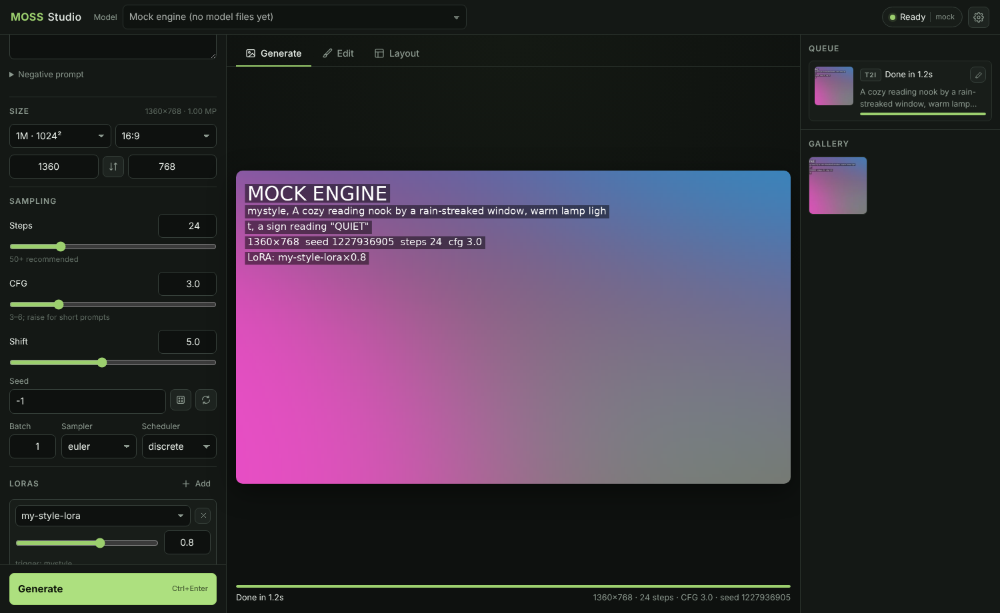

# MOSS Studio

A FastHTML front end for **MOSS-Image** (`OpenMOSS-Team/MOSS-Image-SFT`) running on **stable-diffusion.cpp**:
GGUF quants with a one-click quant switch, LoRA stacking, img2img / inpaint / outpaint, a visual layout
(bounding-box) editor, a local-LLM prompt enhancer, a job queue with live previews, and a gallery.



## Why sd.cpp + GGUF (and not diffusers)

MOSS-Image is a ~5B DiT **plus a Qwen3.5-9B text encoder**. In BF16 through diffusers that is roughly 10 GB for
the DiT alone, before the encoder, which is too much for a 12 GB RTX 4070. The GGUF files run on stable-diffusion.cpp
(which added day-0 MOSS support on 2026-10-16), and its `sd-server` gives this app:

* a native async job API with live preview frames and cancel
* structured LoRA loading (`.gguf` / `.safetensors`)
* img2img + masks (the basis of the Edit tab)
* models that stay loaded between jobs. The app starts and stops `sd-server` for you. Switching quant restarts it.

| DiT file | Weights in VRAM* | Notes |
|---|---|---|
| `MOSS-Image-SFT-Q4_K_S.gguf` | ~3.3 GB | default on a 12 GB card |
| `MOSS-Image-SFT-Q8_0.gguf` | ~5.4 GB | closer to BF16; fine on 12 GB with CPU offload |
| `moss_image_sft_bf16.safetensors` | ~9.7 GB | optional `--bf16` download; needs offload, slower |

\*DiT parameters only, as measured by the GGUF repo's author. The text encoder, VAE and activations come on top.
Keep **Offload to CPU** on (it's the default).

## Setup (Windows, NVIDIA)

1. **Unzip** into `C:\_activeDev\moss_image`.
2. **stable-diffusion.cpp binary.** From <https://github.com/leejet/stable-diffusion.cpp/releases> take a build
   from **2026-10-16 or later** and download two zips:
   * `sd-master-<hash>-bin-win-cuda12-x64.zip`
   * `cudart-sd-bin-win-cu12-x64.zip` (the CUDA runtime DLLs)

   Extract **both** into `moss_image\sdcpp\`, so that `sdcpp\sd-server.exe` exists.
   (To use another location, set `SD_SERVER_BIN` in `.env`.)
3. **Python env + models**
   ```bat
   py -3 -m venv .venv
   .venv\Scripts\activate
   pip install -r requirements.txt
   python scripts\download_models.py --quant q4 q8
   ```
   This fetches both DiT quants, `Qwen3.5-9B-Q4_K_M.gguf`, the FLUX.2 VAE and the Qwen3.5 tokenizer into `models\`.
   Run `python scripts\download_models.py --list` to see the plan first. Other options: `--te Q6_K` and `--bf16`.
4. **Run** `start.bat`, or `python app.py`, then open <http://127.0.0.1:5001>.
   The pill in the top right turns green when the model has loaded. Click it to see the engine log.

To try the UI without a GPU, open ⚙ and pick **Mock**. It produces placeholder images through the same API,
so every feature works end to end.

## Using it

**Header.** The **Model** dropdown is the quant switcher; changing it restarts the engine with that file.
⚙ opens the engine settings: text encoder, VAE, tokenizer, offload, flash attention, VAE tiling, extra
`sd-server` flags, and the live log.

**Generate.** The defaults follow the MOSS user guide: 50 steps, CFG 3 (3 to 6 works; raise it for short
prompts), shift 5, Euler with the discrete scheduler. Size presets are the official pixel budgets
(0.25M / 1M / 1.5M / 2M / 4M) × 15 aspect ratios, always snapped to multiples of 16. Put text you want rendered
in quotes, with real line breaks. The negative-branch skip of layer 22 (MOSS's default guidance) is built into
sd.cpp. The *SLG* fields under Advanced are an optional extra pass.

**Edit.** MOSS-Image has no instruction-edit model, so this tab cannot do Kontext-style "make him smile".
What it does do:

* **Img2img (no mask):** re-renders the whole image. Strength 0.3–0.6 keeps the composition.
* **Inpaint:** paint a mask (B = brush, E = eraser, `[` and `]` change the size). Only the white area changes.
  Use strength 0.85–1.0.
* **Outpaint:** set pixels on any side, or click +25%. The new area is pre-filled with blurred edge colour and
  masked. Use strength 0.9–1.0 and describe the whole widened scene.

To get an image into the tab, drag it in, upload it, or use the ✎ button on any result or gallery image. Chained
edits work, so you can edit a result and then edit that result. *Work size* resizes the source to a pixel budget.

**Layout.** This tab builds MOSS's experimental JSON layout prompts:

1. Pick Object / Character / Text and drag a box on the canvas.
2. Describe each box. Text boxes take the exact text to render.
3. Write a scene caption.

Boxes rescale when you change the size. The app compiles the layout to the model's `abs_centralized` / `yxyx`
form, which you can see under *Compiled prompt*. Import and Export use readable top-left `xyxy` JSON, and Import
also accepts a compiled prompt. **Auto-layout** asks your local LLM to propose boxes from the idea in the prompt
box.

**Enhance** uses any OpenAI-compatible server to expand a short idea with the official MOSS prompt-enhancer
rules. By default that is LM Studio at `http://127.0.0.1:1234/v1`, so start its server first. For that reason
the engine uses port **7861**, not sd-server's default 1234. Set `ENHANCER_URL` / `ENHANCER_MODEL` in `.env`
to change this.

**LoRAs.** Drop `.gguf` or `.safetensors` files into `models\loras\`, then click **+ Add** and set the weight.
`sd-server` ignores `<lora:…>` tags in the prompt, so the app sends LoRAs as structured fields.
Trigger words go in `models\loras\loras.json` (copy `loras.example.json`). With *Auto-add trigger words* on,
the trigger is prepended for you. For example:
```bat
python scripts\download_models.py --no-dit --no-te --lora axiomofmind/Moss-image-nsfw-uncensored-lora-GGUF:MOSS-Image-NSFW-Uncensored-LoRA-F16.gguf
```
That LoRA's own example script uses trigger `moss_xvstyle` at weight 0.7, and the example `loras.json`
already holds those values.

**Gallery.** Images save to `outputs\YYYY-MM-DD\` with a `.json` sidecar holding every setting, the layout
draft and the edit info. sd.cpp also embeds its own PNG metadata. *Reuse settings* restores the prompt, sampling
settings, seed, LoRAs and layout.

## Remote GPU (RunPod etc.)

On the pod, start `sd-server` with the same model flags plus `--listen-ip 0.0.0.0 --listen-port 7861`. Then
choose **Remote** in ⚙ and enter `http://<pod>:7861`. `sd-server` has **no authentication**, so reach it through
RunPod's proxy URL or an SSH tunnel (`ssh -L 7861:localhost:7861 …` → `http://127.0.0.1:7861`) rather than an
open port. In remote mode the quant is whatever the pod loaded.

## Troubleshooting

* **Engine pill is red:** open ⚙. The log shows the exact `sd-server` command and its output, and missing files
  are listed by name.
* **Out of memory:** use the Q4 DiT, keep Offload to CPU on, and turn on VAE tiling for 2M+ px. A smaller text
  encoder (`--te Q4_K_S`) also helps.
* **No live preview:** the default `proj` preview may not exist for MOSS's latent space in your build. Under
  Advanced, set Preview to `vae` with *Every N steps* = 5, or set it to `none`.
* **`invalid generation parameters` (HTTP 400):** usually an sd.cpp build older than 2026-10-16, or a
  sampler/scheduler that this build lacks.

## Layout of this folder

```
app.py                 FastHTML routes
moss/engine.py         sd-server process manager + native API client (managed / remote / mock)
moss/jobs.py           background job polling, gallery saving
moss/layout.py         layout draft → MOSS prompt compiler, size presets
moss/imaging.py        edit-mode prep: resize, masks, outpaint padding
moss/enhancer.py       LM Studio / OpenAI-compatible prompt + layout enhancer
moss/mock_server.py    fake sd-server for GPU-free testing
static/                app.js, layout.js, app.css, vendored htmx (works offline)
scripts/download_models.py
models/{diffusion_models,text_encoders,vae,tokenizers,loras}/
outputs/  data/        generated images / settings, uploads
```

Credits: MOSS-Image by OpenMOSS (Apache-2.0); the layout compiler and enhancer prompts are adapted from
OpenMOSS's `moss-image-prompt-enhancer` skill. GGUF conversions by axiomofmind. Inference by leejet's
stable-diffusion.cpp.
